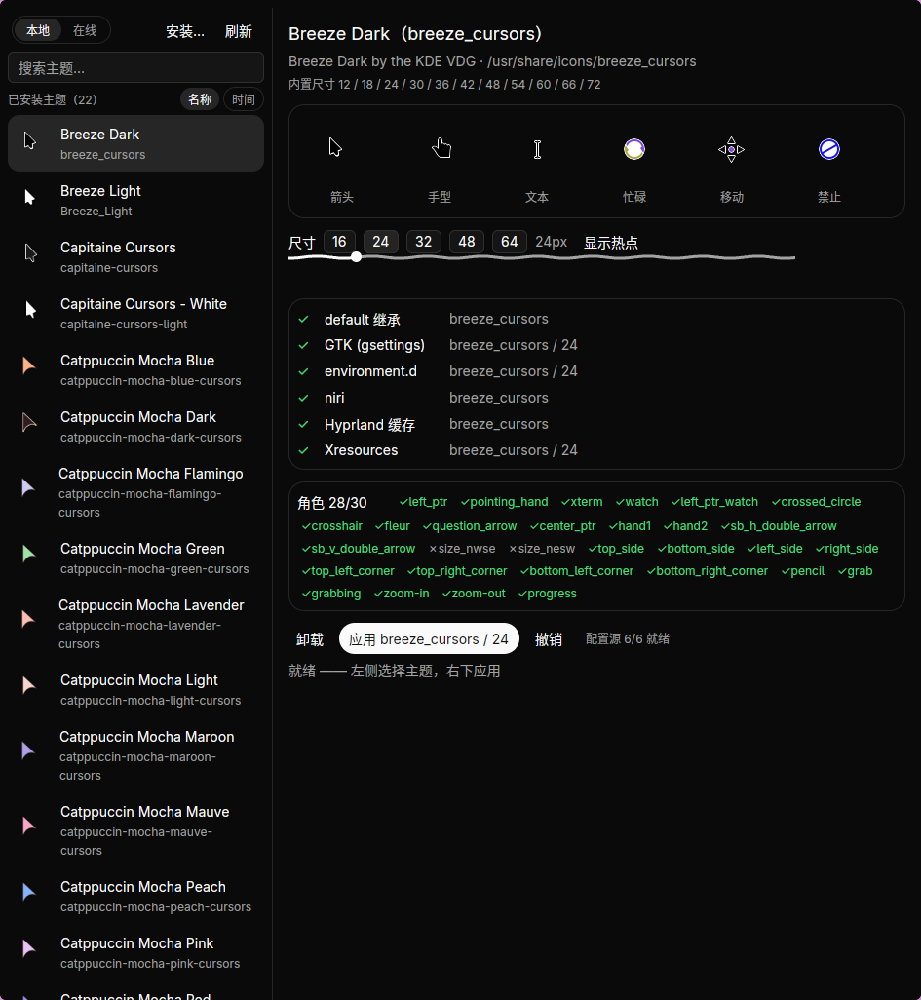

# cursor-manager

Linux 桌面光标主题管理器。预览、应用、安装、卸载、在线下载 XCursor 主题。



 

## 安装

需要 Rust 1.85 或更新版本。

```bash
git clone https://github.com/sijin-xb/cursor-manager.git
cd cursor-manager
./install.sh
```

`install.sh` 构建 release 版本，装到 `~/.local/bin`，并注册 `.desktop` 入口。

## 启动

```bash
cursor-manager
```

点主题选中，「应用」或 `Enter` 生效。
`↑` / `↓` 切换，`Delete` 卸载（需二次确认）。

## 文档

- [使用说明](docs/usage.md)：安装格式、在线源、配置写入位置、排障
- [问题反馈](https://github.com/sijin-xb/cursor-manager/issues)

## 许可

MIT
